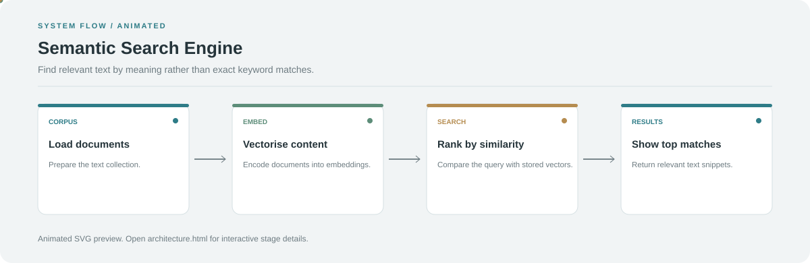

# Semantic Search Engine

**Find relevant text by meaning rather than exact keyword matches.**

[](https://github.com/chyk2468/Semantic-Search-Engine)

## 1. Project Title & Tagline

Find relevant text by meaning rather than exact keyword matches.

## 2. Problem Statement

Keyword search can miss useful results when a query and a document use different words for the same idea. Semantic search ranks content by vector similarity.

## 3. Project Preview

Add a current screenshot, GIF, or deployed demo link showing the interface and its main interaction.

[Open interactive architecture](architecture.html)

## 4. Overview

The application organises the main workflow into clear stages, from the initial input through processing to the user-facing result.

## 5. Key Features

- Convert text and queries into embeddings.
- Store searchable document vectors.
- Retrieve results by semantic similarity.
- Inspect ranked matches for a query.

## 6. Architecture / Workflow



Open the [interactive architecture explorer](architecture.html) to select a stage and inspect its role.

## 7. Tech Stack

Python and the embedding, vector-search, and UI libraries specified in the repository

## 8. Installation & Setup

```bash
git clone https://github.com/chyk2468/Semantic-Search-Engine.git
cd Semantic-Search-Engine
python -m venv .venv
```

Install the project's requirements and configure the expected data or model paths.

## 9. Usage

Run the documented entry point, load or index the corpus, submit a natural-language query, and inspect the ranked passages. Test with paraphrased queries as well as exact keywords.

## 10. Project Structure

Start with the main search application, then inspect document loading, embedding generation, vector indexing, and ranking code.

## 11. Results & Demo

Add a small query set and compare semantic results with keyword search. Report ranking quality only when it has been evaluated on labelled queries.

## 12. Future Enhancements

- Add filters and source metadata.
- Support incremental indexing.
- Add a retrieval benchmark with labelled queries.
- Show why each result was retrieved.

## 13. License

Check the code, embedding model, and source-data licences before redistribution.
