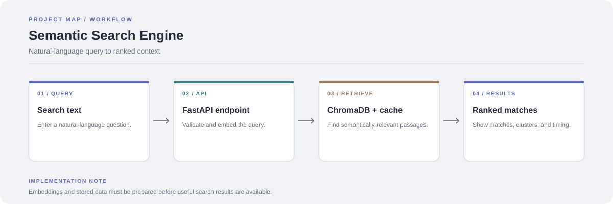

# Semantic Search Engine

Search a collection by meaning rather than relying only on exact keyword matches. The project combines a React/Vite frontend, a FastAPI service, Sentence Transformers embeddings, and ChromaDB vector retrieval.

**Stack:** React, Vite, FastAPI, Sentence Transformers, ChromaDB, Docker



## Request flow

1. The frontend collects a natural-language query.
2. FastAPI validates the request and creates a query embedding.
3. The retrieval service checks its semantic cache and searches the vector store.
4. The API returns matching content and useful retrieval metadata to the frontend.

## Components

- `frontend/`: React/Vite interface
- `backend/app.py`: search API
- `backend/semantic_cache.py`: semantic caching
- `scripts/`: embedding and clustering stages
- `data/`: source dataset and ChromaDB store
- `docker-compose.yml`: local multi-service setup

## Run with Docker

```bash
git clone https://github.com/chyk2468/Semantic-Search-Engine.git
cd Semantic-Search-Engine
docker compose up --build
```

Open the frontend at `http://localhost:5173`. The backend API is available at `http://localhost:8000`.

## Run without Docker

Install Python dependencies from `requirements.txt`, process the dataset with the scripts or Windows helper provided, then run the API:

```bash
uvicorn backend.app:app --host 0.0.0.0 --port 8000 --reload
```

In a second terminal, start the frontend:

```bash
cd frontend
npm install
npm run dev
```

Follow the project's data-processing steps before querying a fresh checkout.
