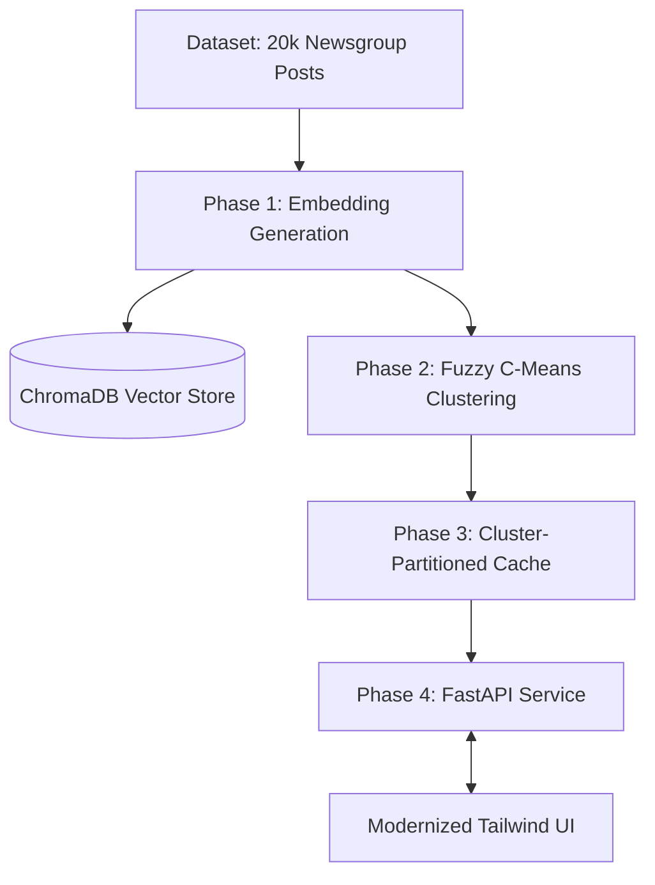

# 🚀 Trademarkia Semantic Search Engine

[](https://fastapi.tiangolo.com/)
[](https://www.python.org/)
[](https://www.trychroma.com/)
[](https://github.com/chyk2468/Semantic-Search-Engine)

A high-performance semantic search system built on the 20 Newsgroups dataset. This system utilizes deep learning embeddings, fuzzy clustering for semantic partitioning, and a custom-built semantic cache to provide fast, relevant search results across nearly 20,000 documents.

---

## 🏗️ System Architecture



## ✨ Key Features

### 🔍 AI-Powered Semantic Search
*   **Deep Learning Embeddings:** Utilizes the `all-MiniLM-L6-v2` transformer model for high-precision semantic vectors.
*   **Vector Database:** Powered by **ChromaDB** with metadata-based semantic filtering for rapid retrieval.
*   **Aggressive Sanitization:** Automated pipeline to strip 15+ types of technical newsgroup headers, ensuring clean, human-readable results.

### 🧠 Advanced Clustering & Caching
*   **Fuzzy Partitioning:** Uses Fuzzy C-Means clustering to recognize documents that span multiple topics (e.g., Religion and Politics).
*   **O(N/K) Semantic Cache:** A custom-engineered cache that lookups queries within their specific semantic cluster, providing up to **8x faster** responses for related queries.
*   **Fuzzy Membership Visualization:** Real-time UI feedback showing the "semantic spread" of your query across different topics.

### 💻 Windows & DevOps Optimized
*   **One-Click Deployment:** Native Windows `.bat` scripts for environment setup, data processing, and server execution.
*   **Container Ready:** Full `Dockerfile` and `docker-compose` support for seamless cross-platform deployment.

---

## 🛠️ Getting Started (Windows CMD)

### 1. Initialize Environment
Run the setup script to create a virtual environment and install all dependencies:
```cmd
setup.bat
```

### 2. Process Data (Optional)
If you wish to re-process the raw dataset and re-generate the embeddings and clusters:
```cmd
process_data.bat
```

### 3. Run the Service
Launch the FastAPI server and open your browser to **[http://localhost:8000](http://localhost:8000)**:
```cmd
run.bat
```

---

## 📊 API Reference

### `POST /query`
Performs a semantic search with detailed performance metrics.

**Payload:**
```json
{
  "query": "What are the latest developments in space exploration?"
}
```

**Response Highlights:**
*   `cache_hit`: Boolean indicating if the result was served from the semantic cache.
*   `dominant_cluster_name`: Human-readable topic (e.g., "Science & Medicine").
*   `cluster_distribution`: Fuzzy membership scores across all 5 clusters.
*   `response_time_ms`: Server-side processing time in milliseconds.

---

## 📁 Project Structure

*   `app.py`: FastAPI service with singleton state management.
*   `semantic_cache.py`: Core logic for the cluster-partitioned semantic cache.
*   `phase1_embed.py`: Data ingestion, cleaning, and embedding generation.
*   `phase2_cluster.py`: Dimensionality reduction (UMAP) and Fuzzy C-Means clustering.
*   `static/index.html`: Modern Tailwind CSS frontend.
*   `*.bat`: Windows-optimized automation scripts.

---

## ⚖️ Design Decisions

- **Embedding Model (`all-MiniLM-L6-v2`)**: Selected for its excellent balance between inference speed and semantic quality.
- **Fuzzy Clustering**: Acknowledges that newsgroup posts often span multiple topics, unlike hard clustering (K-Means).
- **Partitioned Caching**: By restricting lookups to relevant semantic buckets, the system maintains $O(N/K)$ complexity as the cache grows.
